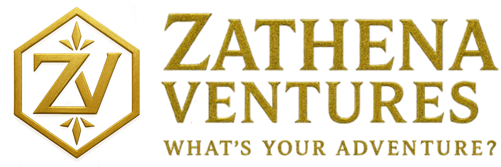
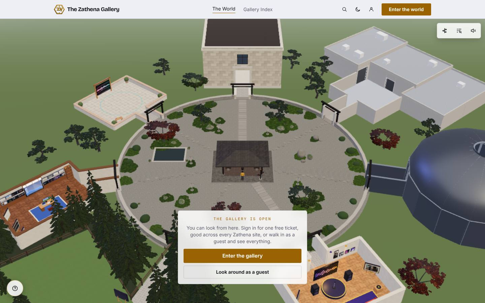
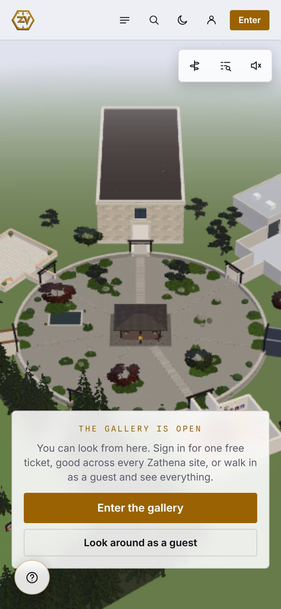

  

<h1 align="center"><a href="https://app.zathenaventures.xyz">The Zathena Gallery</a></h1>

  The Zathena Gallery is 3D Zathena Ventures: the ZV world you walk through instead of a website you scroll. You enter as an avatar, explore a wing for each brand around a central plaza, and open any exhibit onto the live project it shows. It plays like a game, with your own room in place of a profile and other visitors around you.

  <strong>Live site:</strong> <a href="https://app.zathenaventures.xyz">app.zathenaventures.xyz</a>

  <a href="#what-it-is">What it is</a> · <a href="#features">Features</a> · <a href="#book-or-get-in-touch">Get in touch</a> · <a href="#connected-brands">Connected brands</a>

  
  
  
  
  

<table>
  <tr>
    <td align="center" valign="top"> Desktop: the central plaza with the brand wings around it.</td>
    <td align="center" valign="top"> Mobile: the same world on a phone, with tap to move.</td>
  </tr>
</table>

## What it is

Zathena Ventures has two front doors. [zathenaventures.xyz](https://zathenaventures.xyz) is the studio's website. The Zathena Gallery is the other one: a separate experience where the ZV world is something you stand inside.

You arrive at a plaza and walk. Six themed wings surround it, one for each brand in the Zathena ecosystem: Zathena Ventures, ZV Media, ZV Labs, ZADAN, The Wednesday Wanderer and Michael B. Hughes-Isbell. Client work hangs in whichever wing fits it, and every exhibit opens onto the live project. You can look around as a guest, or sign in and step in as your own character, with a room of your own instead of a profile page and other visitors you can see and talk to.

## Features

### The world
- **Walk it your way**: WASD, the arrow keys or a tap, with a character you can customize.
- **A wing per brand**: each one themed to what that brand makes.
- **Exhibits that lead somewhere**: info cards that open the live work they show.
- **Day and night**: in the interface and in the world itself.

### Ways in
- **Look around as a guest**: see everything without an account.
- **One sign-in across the ecosystem**: one account, by emailed link, shared with the other Zathena sites.
- **A flat [gallery index](https://app.zathenaventures.xyz/gallery/)**: every exhibit as a plain page, for anyone who would rather read than walk.

### Built for everyone
- **Search, help and sound controls** always in reach.
- **A published [accessibility statement](https://app.zathenaventures.xyz/accessibility/)**, plus plain [privacy](https://app.zathenaventures.xyz/privacy/), [cookie](https://app.zathenaventures.xyz/cookies/) and [terms](https://app.zathenaventures.xyz/terms/) pages.

## Book or get in touch

Want a walkable world like this for your own brand? [Book a free consult](https://zathenaventures.xyz/contact?book=consult) or use the [contact page](https://zathenaventures.xyz/contact) at Zathena Ventures.

## Connected brands

- **[Zathena Ventures](https://zathenaventures.xyz)**: the studio and central hub ([repo](https://github.com/ZATHENA-VENTURES/ZathenaVentures-Public)).
- **[ZV Media](https://zvmedia.xyz)**: film, video, photography and sound.
- **[ZV Labs](https://zvlabs.xyz)**: games.
- **[ZADAN](https://zadan.xyz)**: singer-songwriter.
- **[The Wednesday Wanderer](https://twwpodcast.xyz)**: weekly podcast.
- **[Michael B. Hughes-Isbell](https://michaelbisbell.com)**: portfolio.

## License

© 2026 Zathena Ventures. All rights reserved.

## Credits & Contact

- **Live site:** [app.zathenaventures.xyz](https://app.zathenaventures.xyz)
- **Built and hosted by:** [Zathena Ventures](https://zathenaventures.xyz)

> This is the public showcase of a private repository. It presents the project, its features and its live site, and leaves out source code and deployment details.
